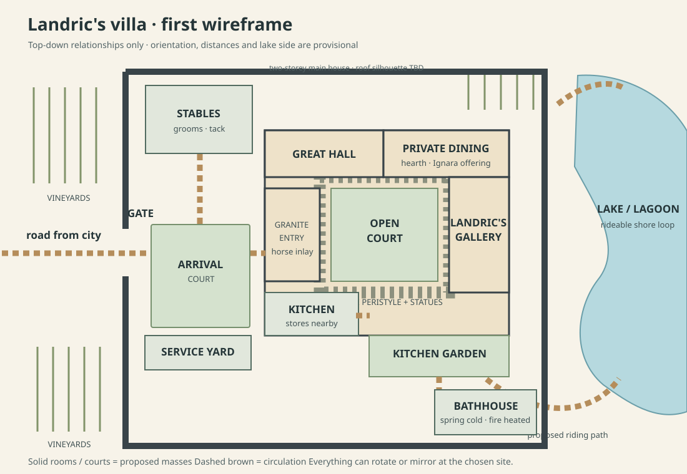

# Landric's villa — first wireframe

## Blender visual references

The [SVG wireframe](landrics_villa_wireframe.svg) is the layout reference. The two generated images show a consistent **painted miniature** interpretation for massing, roofs, light, vineyards and garden. Use them as concept art: small objects and room divisions in the overhead image are illustrative, not fixed canon. In particular, the image's visible bedroom placement and the precise lake shore and bathhouse shapes were invented for legibility. Match the chapter's route and room relationships below when constructing the model. The [generation prompts](landrics_villa_image_prompts.md) are recorded for later variants.

**Suggested first Blender pass:** block out the wall, gate, arrival court, stable, two-storey main ring, open peristyle, gallery wing, kitchen garden, detached bathhouse, vineyard rows and lake edge as separate named masses. Make one dusk three-quarter camera that reads like the aerial image and one orthographic overhead camera for checking the layout. Keep the whole site smaller than Calderra's city plinth; final real-world dimensions and map coordinates wait for site selection.

The [animation and event brief](landrics_villa_motion.md) gives ambient loops, four chapter-based sequences, optional vignettes and proposed route anchors for the Blender/Atlas build.

This is a **layout proposal**, not a settled map location or a production building plan. The diagram uses north-up and puts the lake on the right solely to make the route readable; rotate or mirror the entire estate when its site is chosen. Rectangles show relationships, not measured footprints.

## What Chapter 1 establishes

| Element | Text evidence | Design consequence |
|---|---|---|
| Setting | The party rides out from the palace through its west gate, through the city, past a village near the second river, then reaches the villa after sunset (lines 198–272). | Put the estate outside the city, along a rideable road. The chapter does not fix its compass position or distance. |
| Arrival | Lamps light both stories and the court wall; Yseult waits by a gate; a path runs inward; stable boys take the horses (272–308). | A walled arrival court, obvious gate, lit two-storey main mass and nearby horse handling. |
| Land and water | Vineyard surrounds the villa; the villa has its own wine; a nearby lake or lagoon has a rideable circuit (272, 324, 328–332). | Vineyard parcels around the enclosure and a route from stable to lakeside loop. Lake shape and shore distance remain open. |
| Interior | Polished Kervaran granite floor uses darker horse designs as wayfinding; family eats in a private dining room with a hearth, rather than the great hall (310–316). | Entry hall with horse-pattern wayfinding; separate private and formal dining rooms. |
| Courtyard route | From the dining room, Radgar and Landric walk around the central courtyard's marble peristyle, then enter Landric's gallery at its end (378–384). | A continuous cloister path links dining and gallery around an open central court. |
| Bath route | Radgar leaves the gallery, crosses the peristyle, then reaches a bathhouse at the back of the kitchen garden; it has a natural cold spring and a fire-heated pool (432–434). | Gallery, peristyle, kitchen garden and separate bathhouse must form a walkable sequence. |

## Proposed spatial logic

1. **Arrival axis:** road → wall gate → lit court → granite entrance hall. Keep the stable court adjacent to the gate so horses do not cross the family courtyard.
2. **Family axis:** entrance → private dining room → peristyle → Landric's gallery. A second, larger great hall branches off the entrance for public occasions.
3. **Service axis:** stable/service gate → kitchen and stores → private dining room; kitchen → kitchen garden → bathhouse fuel room. This is a proposed functional connection, not stated in the chapter.
4. **Garden axis:** the open courtyard sits inside a roofed, columned walkway. Oravessan statues occupy bays along the peristyle; the gallery terminates one side, making the walk in Chapter 1 legible.
5. **Estate axis:** vineyards frame the villa; a path past the stables reaches a loop around the lake/lagoon. Keep the lakeshore open enough for a horse to circle it.

## Readable silhouettes for the map

At distant map scale: show a **two-storey pale villa enclosing one dark open court**, a long perimeter wall with one bright gate, a detached bathhouse, stable block, vineyard rows and the lake edge. At closer scale: reveal marble colonnade, statues, granite horse inlays, gallery windows and warm lamps. The chapter does not specify roof profile, wall material, exact footprint, or whether the bathhouse has a dome; those stay undecided.

## Open decisions before implementation

- **LORE? Site:** which lake/lagoon and which bank, and how far from Calderra's palace? The west gate is the palace departure, not proof that the villa lies due west.
- **LORE? Scale:** estate, house and courtyard dimensions. The current city generator makes generic villas only; this landmark needs a dedicated model or generator feature.
- **LORE? Court wall:** does it enclose only the house and formal grounds, or also the stables and kitchen garden? This draft encloses all three.
- **LORE? Upper floor:** the two stories are explicit, but bedroom positions are not. A later floor plan can place family and guest rooms once the ground floor is approved.
- **LORE? Bath spring:** whether the spring emerges within the bathhouse or is carried into it.

Source: `1. Chapter 1 - Before The Walls.md`, lines cited above. The source is outside this repository; no chapter text was changed.
